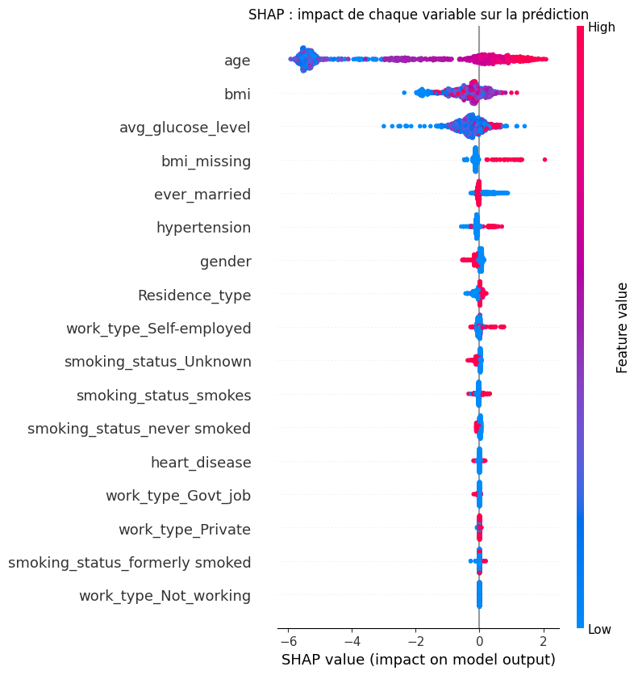
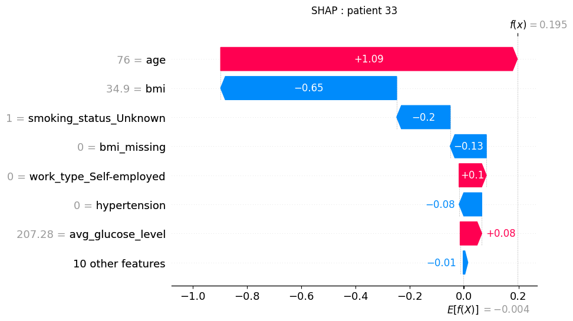

# Stroke Risk XAI : prédire et expliquer le risque d'AVC

Prédiction du risque d'accident vasculaire cérébral (AVC) à partir de données cliniques et démographiques, avec une étude critique de l'explicabilité des modèles (**SHAP**, **LIME**, coefficients, importance par permutation).

Le projet suit une démarche expérimentale : **10 hypothèses** sur les données, les modèles et l'explicabilité, chacune testée par un protocole avec un critère de validation fixé à l'avance.

    

---

## Contexte

L'AVC est l'une des premières causes de décès et de handicap. Un modèle de dépistage n'est utile en clinique que si le médecin peut **comprendre et contrôler** ses prédictions. Le projet cherche donc à répondre à deux questions : quel modèle choisir, et que valent réellement ses explications ?

**Données :** [Stroke Prediction Dataset](https://www.kaggle.com/datasets/fedesoriano/stroke-prediction-dataset) (Kaggle) : 5 110 patients, 10 variables, seulement **4,9 % d'AVC** (jeu très déséquilibré).
Dataset créé par **fedesoriano** (Kaggle), usage pédagogique uniquement. Il est inclus dans ce dépôt avec crédit à l'auteur.

## Démarche

1. **Analyse exploratoire** : tests du Chi² et de Mann-Whitney, détection d'un facteur de confusion (`ever_married` ↔ âge), données manquantes informatives (BMI absent → 4,6× plus d'AVC).
2. **Préparation** : indicatrice `bmi_missing`, imputation après le découpage (pas de fuite de données), one-hot encoding, split 80/20 stratifié.
3. **Modèles** : régression logistique, arbre de décision, Random Forest, XGBoost, MLP, avec pondération des classes et validation croisée sur 5 plis.
4. **Explicabilité** : globale (coefficients, impureté, permutation, SHAP) et locale (SHAP vs LIME sur des patients réels, dont un faux négatif).
5. **Analyse critique** : limites des données et de la méthode, et explication du modèle à un médecin (principes d'IHM).

## Résultats principaux

| # | Hypothèse | Résultat | Verdict |
|---|---|---|---|
| H1 | L'accuracy n'est pas adaptée | Modèle naïf : 95 % d'accuracy, 0 AVC détecté | ✅ Validée |
| H2 | Pondérer les classes aide | Rappel LR : 2 % → 80 % (précision ≈ 14 %) | ✅ Validée |
| H3 | L'absence de BMI est utile | +0,015 d'AUC (LR), effet quasi nul (XGB) | 🟡 Partielle |
| H4 | Les ensembles d'arbres battent la LR | LR meilleure : AUC 0,854 vs 0,846 (RF) et 0,824 (XGB) | ❌ Infirmée |
| H5 | Les arbres s'entraînent plus vite qu'un MLP | Arbre ≈ 300× plus rapide et plus performant | ✅ Validée |
| H6 | Peu de variables suffisent | 4 variables sur 17 : > 98 % de l'AUC conservée | ✅ Validée |
| H7 | L'âge est la variable n°1 partout | 1ʳᵉ selon les 4 méthodes | ✅ Validée |
| H8 | LR et XGB + SHAP concordent | Corrélation de Spearman = 0,49 | ❌ Infirmée |
| H9 | SHAP et LIME concordent | 0 patient sur 5 avec le même top 3 | ❌ Infirmée |
| H10 | `ever_married` n'est pas utilisée | 5ᵉ selon SHAP, et en sens inverse de la statistique brute | ❌ Infirmée |

**À retenir**
- Une **régression logistique pondérée** est aussi performante que les modèles complexes, tout en étant interprétable par nature. Ici, il n'y a pas de compromis entre performance et explicabilité.
- Les méthodes d'explication **s'accordent sur l'essentiel (l'âge) mais divergent sur les détails**, entre elles comme d'un modèle à l'autre : une explication décrit le modèle, pas la réalité médicale.
- L'XAI sert d'**outil de contrôle**, par exemple pour repérer qu'un modèle exploite un facteur de confusion. Elle ne prouve pas la validité clinique du modèle.

<p align="center">
  
  
</p>

## Structure

```
stroke-risk-xai/
├── stroke_risk_xai.ipynb              # notebook complet (sorties conservées)
├── healthcare-dataset-stroke-data.csv # données (fedesoriano, Kaggle)
├── figures/                           # figures clés extraites du notebook
├── requirements.txt
└── README.md
```

## Exécution

Le notebook s'affiche directement sur GitHub, avec toutes ses sorties.

Pour le réexécuter :
1. Cloner le dépôt : le CSV est déjà à côté du notebook.
2. Ouvrir le notebook dans **Google Colab** (importer le CSV dans l'espace Fichiers), ou en local :
   ```bash
   pip install -r requirements.txt
   jupyter notebook stroke_risk_xai.ipynb
   ```

Graine aléatoire fixée (`SEED = 42`) pour la reproductibilité.

## Stack

Python · pandas · NumPy · scikit-learn · XGBoost · SHAP · LIME · SciPy · Matplotlib · Seaborn

## Références

- Lundberg & Lee (2017). *A Unified Approach to Interpreting Model Predictions.* NeurIPS.
- Ribeiro, Singh & Guestrin (2016). *"Why Should I Trust You?" Explaining the Predictions of Any Classifier.* KDD.
- Rudin (2019). *Stop explaining black box machine learning models for high stakes decisions.* Nature Machine Intelligence.
- Grinsztajn, Oyallon & Varoquaux (2022). *Why do tree-based models still outperform deep learning on tabular data?* NeurIPS.
- Slack et al. (2020). *Fooling LIME and SHAP.* AIES.

## Auteure

**Imane Guihia** : élève ingénieure en Génie Digital en Santé (UM6SS), semestre de mobilité à ISIS Castres.
Projet réalisé dans le cadre du module d'explicabilité de l'IA (2026).
